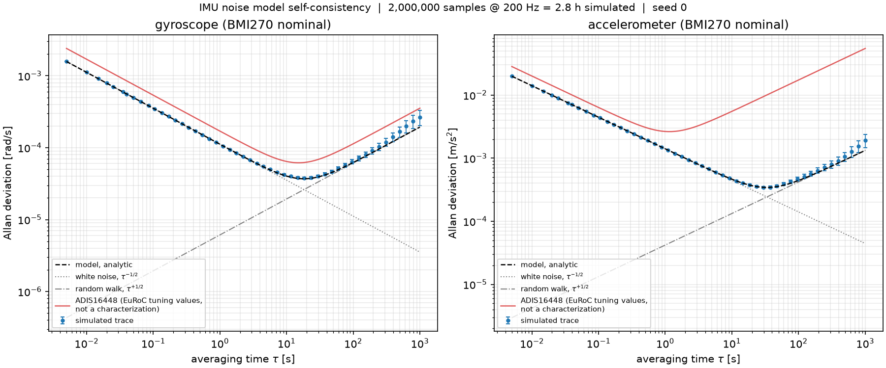
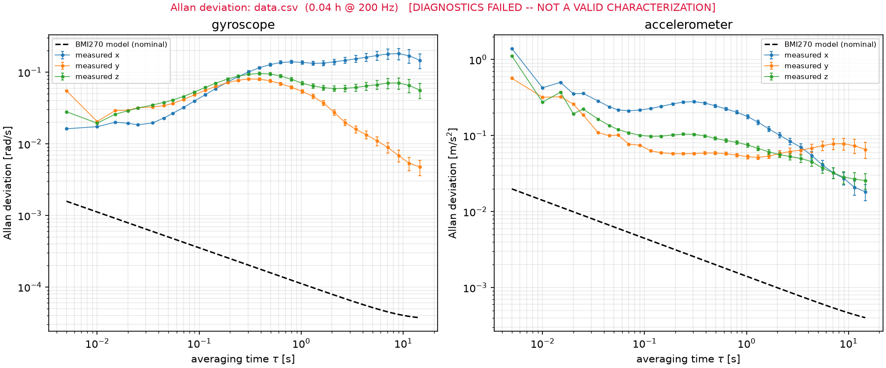
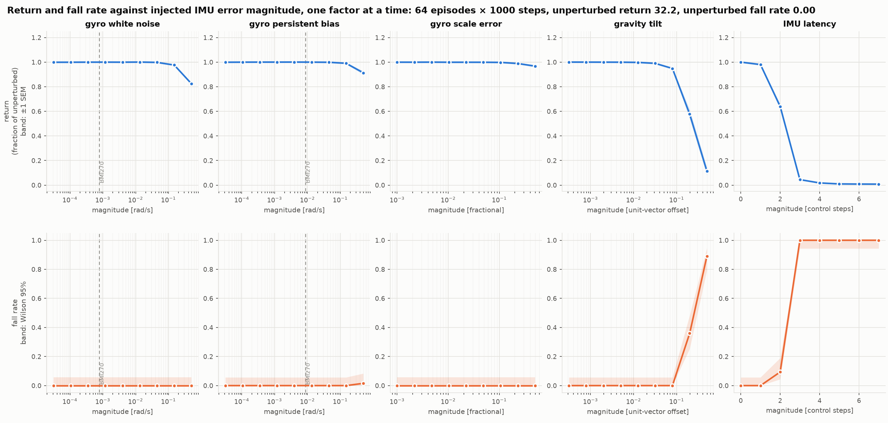
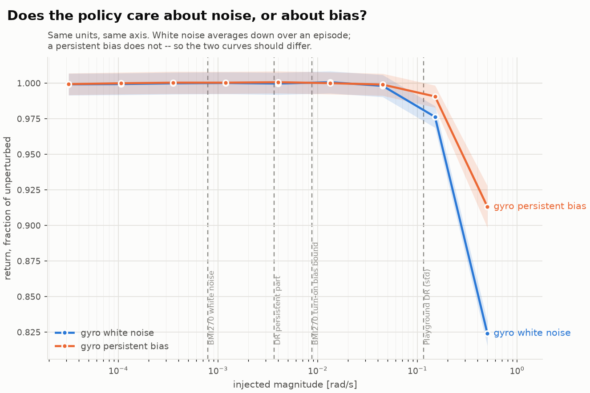
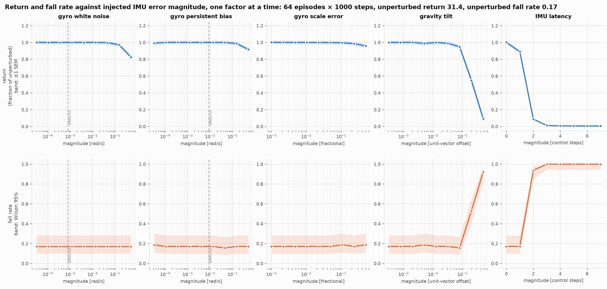
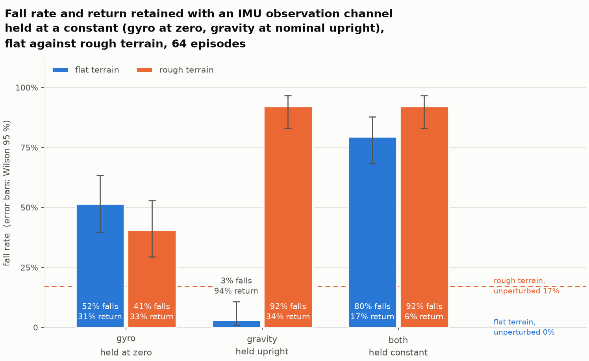
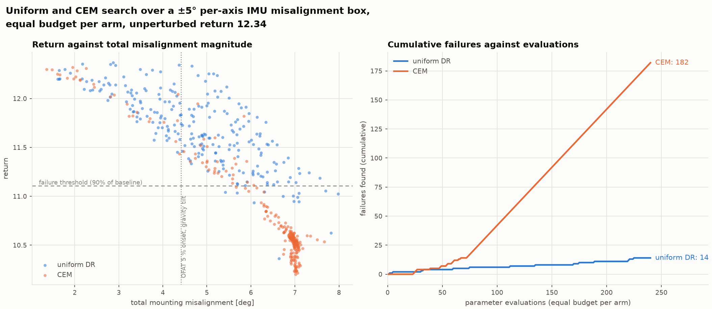
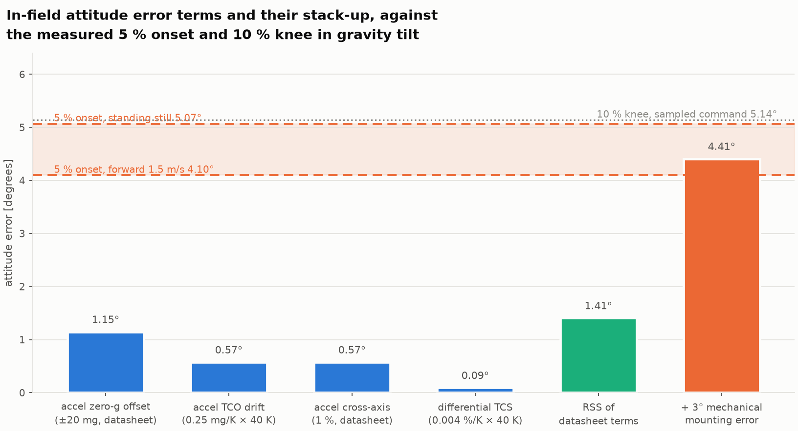

# [TITLE]

<!--
SCAFFOLD. Headings, word budgets, and every measured number you might need,
with its source. Prose is yours; this exists so nothing measured gets lost.

Working titles, pick or replace:
  - "I built a differentiable IMU model to break a robot. It didn't work,
     and the reason was more interesting."
  - "Standard domain randomization over-covers sensor noise by 146x"
  - "The error budget that actually breaks a quadruped policy"
  - "First Foray into Sim2Real: the error budget that actually breaks a quadruped policy"

Figures are referenced relative to this file (reports/figures/...),
so they render in place on GitHub and in most markdown viewers.

Target ~2,800 words. Numbers: docs/findings.md. Narrative: docs/approach_log.md.
Figures: reports/figures/.
-->

## 1. The question and the short answer
<!-- WRITE: Open with the table, then say in two or three sentences what you
set out to test and what the measurement said instead. State once that you
come from sensor physics (magnetic position sensing for camera actuators) and
that this was your first robotics-simulation project -- then let that do its
work. Do not hedge or apologise; the cross-domain angle is why you asked
whether the error budget was the right one at all, and that question is what
produced the result. End the section by telling the reader what they will get:
a measured account of why a physics-parameterized sensor model finds nothing
on this class of system, and where it should be aimed instead. -->
<!-- ~250 words. Verdict in the first paragraph. Do not make the reader earn
it. Open with the table; prose after. -->

| Premise | Verdict |
|---|---|
| failures exist in the physics-parameterized noise space | **no** — every channel 25–635x clear |
| …but they exist in attitude error | **yes** — onset 4.5°, field stack-up 4.41° |
| gradients flow through the simulator | **no** — correct only to H=10 (0.2 s) |
| randomized smoothing rescues them | **no** — mean indistinguishable from zero |
| adaptive search beats uniform sampling | **yes** — 13x more failures |
| …and finds *worse* failures | **no** — 1.5 % difference |
| …and finds *diverse* failures | **no** — collapsed to one mode |

<!-- State your background once, here, and let it work: you came from sensor
physics, which is why you asked whether the error budget was the right one.
Do not apologise for it being a first robotics project. -->

I've been seeing a lot of dialogue about Sim2Real in the (mostly online) robot circles I've found myself and given my background as a sensing system engineer (mainly magnetic position sensors for camera actuators), I wanted to explore a sensing-first approach to robot simulation. The problem I posed is as follows: if you could create a differentiable, physics-based model of a sensor (in this case, an IMU), what insight could you gain into a robot policy's sensitivity to physically derived attributes of the IMU, and hence search out failure modes in simulation that would correspond to different attributes on a datasheet? Maybe a bit ambitious for a first robot simulation project, but something I felt with coding agents I could get some nice insight in to help guide my understanding :)  

TLDR: what I found is that (at least for the walking quadruped problem) there aren't policy failures in the physics-parametrized space of the IMU (Allan-variance terms: noise density, bias instability, random walk) but rather from sources that wouldn't be captured at the component level - misalignment and latency.

---

## 2. Why this looked like a good bet
<!-- WRITE: Make the argument a sensor engineer would make. Domain
randomization in these pipelines is not a sensor model -- it is regularization
noise, and nobody derived +-0.2 rad/s from a datasheet. Show the 146x gap and
the seven-robots-one-constant detail, because together they establish the
value is a convention rather than a calibration. Then state the hypothesis
that follows and that you genuinely believed: if DR is not physics, a
physics-parameterized search should find failures it misses. Include the
caveat that per-episode bias DR exists in the wider literature -- putting it
here, before the results, is what makes the rest credible. -->
<!-- ~400 words. The motivation, argued FROM sensor physics. -->

<!-- KEY NUMBERS
  Playground gyro DR: uniform +-0.2 rad/s -> std 0.1155 rad/s
  BMI270 gyro white noise @ 50 Hz:        std 7.9e-4 rad/s
  Ratio:                                  146x
  Identical gyro=0.2, gravity=0.05 across SEVEN robots: Go1 joystick,
    Go1 handstand, Go1 getup, G1, Berkeley Humanoid, Apollo, T1 --
    quadrupeds and bipeds alike. A copied default, not a calibration.
  Honest caveat: per-episode IMU bias DR DOES appear in the wider
    literature (RSS 2018 Minitaur). "DR omits structured errors" is true
    of Playground, not of the field.
-->

What typically occurs within the robot simulation is this notion of domain randomization. For more kinematic and rigid-body problems, having parameters like mass, friction, and rigidity be randomized over a window of values can give you some valuable insights into the sensitivity of your policy to variations in the physical environment and ideally give you some data on how to best generalize it. I was curious taking this approach but more on the perception/sensing side. Domain randomization here is not a physic-informed model, at least from the available datasets I was seeing for IMU-locomotive tasks. It seems that a rather over-conservative approach is taken, with a common bounding value of +/- .2 rad/s (STD = 0.12 rad/s) is taken, which a ways larger from what's quoted in IMU spec sheets (for example, BMI270 quotes gyro white noise @ 50 Hz a STD = 7.9e-4 rad/s). This was seen across 7 different publicly available models that I came across: Go1 handstand, Go1 getup, G1, Berkeley Humanoid, Apollo, T1 -- quadrupeds and bipeds alike. So more like a default 

---

## 3. What I built
<!-- WRITE: Enough for a reader to trust the instrument, no more. The model
follows Kalibr conventions so the parameters map onto how the field talks; it
is reparameterized so gradients reach the distribution parameters. Emphasise
what validation actually established -- self-consistency plus an independent
cross-check -- and be explicit that recovering your own inputs is not
validation against reality. The EuRoC rejection is worth a short paragraph: it
shows you checked whether your data met the method's assumptions instead of
running the method anyway, and the 150x wrong answer it produces when forced
is a memorable illustration. Mention the 11-12 % per-realization scatter on
random walk, because it bounds what any single real log could ever tell
you. -->
<!-- ~500 words. Credibility section. Concrete, not exhaustive. -->

<!-- KEY NUMBERS
  Model: Kalibr conventions, reparameterized so eps is drawn outside and
    gradients flow through distribution parameters.
  Allan self-consistency, 16 realizations x 2e6 samples:
    noise density ratio 1.000 (0.1 % spread)
    random walk ratio 1.01-1.04, 11-12 % spread PER REALIZATION
    -> a single real static log cannot pin random walk better than ~+-15 %
  Independent cross-check: generator and estimator paired against a
    separately written validation package in both directions.
  Mutation tests verified to fail for the right reason:
    sqrt(2) in white density -> N moves to 1.4132, K stays 0.9812
    dropped /3 in RW term    -> K moves to 1.7020, N stays 0.9993
  EuRoC was proposed and rejected: no static segment anywhere (quietest
    10 s window peaks at 0.58 rad/s), 85-145 s records. Forced through, the
    estimator returns 0.025 rad/s/sqrt(Hz) against a published 1.70e-4 --
    150x high. Retained as a figure: allan-euroc-contaminated.png
  Figure: allan-self-consistency.png
-->

---

  

<!-- FIGURE: the credibility anchor. Say that the simulated trace tracks the
analytic curve across four decades of tau, that the error bars widen at long
tau because few independent clusters remain there, and that the ADIS16448
reference is EuRoC's estimator TUNING values, not a characterisation -- which
is why a navigation-grade part appears to sit above a consumer one. -->

  

<!-- FIGURE: optional but memorable. The estimator returns a gyro noise
density 150x the published value because the record is not stationary. Use it
to make the point that a method which silently returns a plausible number on
invalid data is more dangerous than one that errors. -->

## 4. What I measured
<!-- WRITE: Let the figures carry the argument and use prose only to connect
them. Go in the order the work actually went, because each result motivated
the next: nothing fails in the noise space, so test whether that is an artifact
of easy terrain; it is not, so test whether the channel is used at all; it is,
which inverts the story; then the gradients, then the search. Resist
summarising each subsection -- state the number, say what it rules out, move
on. The ablation reversal is the one place to slow down. -->
<!-- ~800 words. Figures carry this; prose connects them. -->

### 4.1 Nothing in the noise space breaks it
<!-- WRITE: Lead with the margins, since 635x is the kind of number that
settles an argument. Then spend most of the space on the refuted hypothesis:
you expected persistent bias to break the policy where i.i.d. noise did not,
because only the former survives 1/sqrt(N) averaging over an episode. Show the
two curves lying on top of each other. Note that this policy trained with no
observation noise at all, which rules out the obvious explanation that DR
hardening caused the robustness. -->
<!-- Figures: ofat-all-factors.png, ofat-white-vs-bias.png
  64 episodes x 1000 steps. Baseline return 32.18, fall 0.00, survival 1.00.
  gyro white noise    knee 0.50 rad/s      635x BMI270
  gyro persistent bias no knee in range    57x
  gyro scale error     no knee; 50 % error costs 3 %
  gravity tilt         knee 0.20 (11.3 deg) ~10x
  IMU latency          knee 2 steps (40 ms) ~7x
  The structural hypothesis (persistent bias survives 1/sqrt(N) averaging,
  so should knee earlier) is REFUTED: the two curves sit on top of each
  other and bias is if anything better tolerated.
  Policy trained with noise_level = 0.0 -- no observation DR at all -- so
  the robustness is not DR hardening.
-->

  

<!-- FIGURE: the main sweep. Four of five panels are flat lines and that IS
the result -- point it out rather than apologising for it. Only gravity tilt
and latency bend. Shaded bands are +-1 SEM on return and Wilson 95 % on fall
rate; mention them, because they are what lets a reader tell a real knee from
a two-episode fluctuation. -->

  

<!-- FIGURE: built to show a divergence that is not there. The two curves lie
on top of each other, which is the clearest possible refutation of the
1/sqrt(N) argument. Worth saying explicitly that you made this plot expecting
them to separate. -->

### 4.2 It generalizes to rough terrain
<!-- WRITE: Short. Say why rough terrain was the right generalization test --
joint-encoder redundancy should depend on predictable ground -- and that you
predicted the gyro margins would shrink. They did not move. Note the controls
that make it a clean comparison (same class, observation, DR, budget, episode
length; comparable final reward) so a reader cannot attribute the null to a
weaker policy. -->
<!-- Figure: ofat-all-factors-rough.png
  Identical class, observation, DR, budget, episode length; only terrain XML
  differs. Rewards comparable (29.62 vs 30.01), so not a weaker policy.
  Every gyro knee unchanged. Only latency moved, 2 steps -> 1.
  Baseline there: fall rate 0.17, survival 0.95.
-->

  

<!-- FIGURE: near-identical to the flat version, which is the point. Note the
baseline differs (fall rate 0.17, survival 0.95) so the comparison is between
knees, not absolute values. Only latency moved. -->

### 4.3 Corruption-insensitive is not unused
<!-- WRITE: The most quotable result; give it room. The distinction is that
every sweep before this one CORRUPTED the IMU rather than removing it, and a
flat response to corruption means robustness, not that the channel is unused.
Removing the gyro costs 70 % of return. Removing gravity costs 6 % on flat
ground and 66 % on rough -- and say that you predicted that gap from the
mechanism (the ablation substitutes nominal upright, which is nearly correct
on flat ground and wrong on rough) before running it. Finish with the
asymmetry that matters for the rest of the piece: a wrong attitude estimate is
far more expensive than a missing one, and in-field drift produces wrong
values, not missing ones. -->
<!-- The most quotable result. Give it the subhead.
  full removal      flat return   flat fall   rough return   rough fall
  gyro              9.86 (-70%)   0.52        10.42 (-67%)   0.41
  gravity           30.25 (-6%)   0.03        10.62 (-66%)   0.92
  both              5.61          0.80        1.90           0.92
  Gyro: essential AND precision-tolerant.
  Gravity: required only where the upright prior fails. Predicted from the
  mechanism BEFORE running the rough case, and confirmed.
  For attitude, wrong information is worse than none: 11 deg of tilt costs
  42 %, removal costs 6 %.
-->

  

<!-- FIGURE: the one to put in a talk. Gyro removal costs ~70 % on BOTH
terrains -- its role does not depend on the ground. Gravity removal costs 6 %
on flat and 66 % on rough, and that gap is the upright prior being right or
wrong. Contrast the 94 % bar against the 42 % cost of merely TILTING gravity
11 deg: wrong information is more expensive than none. -->

### 4.4 The gradients don't work
<!-- WRITE: State the criterion was fixed in week 1, before any of this, then
give the table. The useful framing is that gradients do not explode -- ||g||
actually falls with horizon -- they decorrelate, which is the chaotic-landscape
signature rather than numerical blow-up. H=10 is 0.2 s and a tilt-induced fall
needs far longer, so the usable horizon and the phenomenon never overlap.
Report that smoothing was the planned mitigation and that it recovered no
signal. Worth one line that the Warp backend supports no reverse-mode AD at
all, since anyone rebuilding this will hit it. -->
<!-- H     AD vs finite diff   sign stability
     10    1.7 %               0.78
     25    78 %                0.78
     50    98 %                0.67
     100   104 %               0.61
  Criterion (C2 < 20 %, C3 > 0.8) fixed in week 1. Correct at 0.2 s,
  meaningless by 0.5 s. NOT exploding -- ||g|| falls as H^-0.39 -- just
  decorrelated. Chaotic-landscape signature (Suh et al., ICML 2022).
  Smoothing over 32 episodes: |mean|/SEM 0.4-2.1, all below 3. No descent
  direction exists.
  Also: Warp backend supports no reverse-mode AD at all; cfg.impl="jax"
  required and slower.
-->

### 4.5 The search that remained
<!-- WRITE: Be explicit that this is the weaker question the claim degrades to
once gradients are gone, and that the gradient arm was ruled out by
measurement rather than skipped. Give the fairness controls (equal budget,
common random numbers, threshold fixed in advance) before the result, because
that is what makes 13x believable. Then be honest about what it does not show:
the worst failure is 1.5 % worse, and CEM collapsed to a single mode. The
brief asked that this exact case be reported if it happened, so say so. -->
<!-- Figure: search-misalign.png
  240 evaluations per arm, common random numbers, 10 % failure threshold
  fixed in advance, +-5 deg/axis box. Baseline 12.34 (400-step horizon).
  uniform DR  14/240 failures   worst 10.36
  CEM        182/240 failures   worst 10.20
  13x discovery rate, 1.5 % severity gain. CEM mode-collapsed:
  sigma 2.82 -> 0.07 deg by gen 9, |mu| locked at 7.0 deg.
  Box corner 8.66 deg RSS vs an 11.3 deg knee, so nothing in-box costs more
  than 17 % of return. Correct physically; shallow by construction.
-->

---

  

<!-- FIGURE: left panel shows where each arm spent its budget, right shows
discovery rate. Draw attention to the CEM cluster collapsing into a vertical
streak near 7 deg -- that is mode collapse made visible, and it is why 13x
more failures does not mean a better result. The uniform points spread across
the box and reach almost the same worst value. -->

## 5. Why it failed: Allan variance characterizes integration
<!-- WRITE: The best idea in the piece -- give it one clear thought and resist
decorating it. Averaging time is the independent variable of an Allan curve, so
every parameter in it describes integrating a rate signal. This policy
integrates nothing: it is memoryless and re-grounded by contact every step.
You characterized the sensor for integration and tested it on a system that
does not integrate, and every result in section 4 falls out of that. Rule out
sensor fusion explicitly, since it is the plausible wrong explanation a reader
will reach for first. -->
<!-- ~400 words. The best idea in the project. One thought, stated plainly. -->

<!-- Averaging time tau IS the independent variable of an Allan curve. Noise
density, bias instability, random walk: all statements about integrating a
rate signal over seconds to hours. Right characterization for inertial
navigation, which is what it was built for.
This policy integrates nothing. Memoryless MLP (512/256/128, SiLU,
tanh-normal), acting instant to instant, re-grounded by contact every step.
The long-tau half of the curve describes a failure mode the task cannot have.
Everything follows: gyro channels flat because nothing accumulates them; the
channels that bind are an instantaneous attitude reference with no
redundancy, and a control-loop stability property. Neither is a noise
parameter.
Note it is NOT sensor fusion: no filter, no history, and gravity is ground
truth in sim rather than estimator output. -->

---

## 6. The error budget that actually binds
<!-- WRITE: Your section. Start with the physics: gravity tilt is a DIRECTION
error, the vector is renormalized, so a common-mode scale error produces
exactly zero tilt -- which is why the sensitive channel is not any single
datasheet line item. Walk the causes as a practising sensor engineer would,
and give g-sensitivity its own sentence, since a bias locked to the gait cycle
is a structurally different error from noise. Then the stack-up table, landing
on 4.41 deg against a measured 4.54 deg onset. The conclusion to state plainly:
the binding error budget is mechanical and estimator-side, while the entire
project targeted Allan-variance parameters. That is the sentence a robotics
hardware reader will take away. -->
<!-- ~450 words. YOUR section. The analysis an ML researcher would not do. -->

<!-- Gravity tilt is a DIRECTION error -- the vector is renormalized, so
common-mode magnitude errors vanish entirely. A uniform scale error produces
exactly zero tilt. Causes, all per-axis:
  temperature: TCO 0.015 dps/K, 0.25 mg/K; TCS 0.02 %/K
  package and PCB stress (why specs read "soldered, lifetime")
  mechanical shock, aging, CRT drifted or never run
  g-sensitivity 0.1 dps/g -- locked to the gait cycle, not noise
  chassis deformation, re-assembly
  IMU mounting misalignment

  tilt source                      degrees
  accel zero-g offset (+-20 mg)    1.15
  accel TCO over 40 K              0.57
  accel cross-axis (1 %)           0.57
  RSS, datasheet only              1.41
  + 3 deg mechanical mounting      4.41
  MEASURED degradation onset       4.54

Gyro comparison is the opposite: in-field drift 0.6-1.0 dps against a knee
at 29 dps.
So: gyro drift is irrelevant in the field; attitude drift is marginal in the
field. And every dominant tilt contributor is persistent, per-axis and
slowly varying -- exactly the structure uniform i.i.d. DR omits. -->

---

  

<!-- FIGURE: your signature plot. Walk it left to right: the datasheet terms
are each under 1.2 deg and RSS to 1.41, then a single mechanical mounting
error roughly triples it to 4.41 deg, landing on the measured 4.54 deg onset.
The 11.28 deg knee sits far above, which is why nothing inside a defensible
box causes collapse. The takeaway to state plainly: the largest term is not
on any datasheet. -->

## 7. What I'd do next
<!-- WRITE: Frame as a program, not loose ends. The first item is the real
successor -- the same experiment on a system that integrates -- and it follows
directly from section 5 rather than being a wish. Items 2 and 3 are the
practical payoffs: nobody randomizes misalignment, and you now have the data
to say what DR should randomize instead. Item 4 is cheap and carries two
pre-registered predictions, which is worth saying because it commits you in
advance. Close on a line that makes a reader want to know what happens when
the system does integrate. -->
<!-- ~300 words. A program, not loose ends.
  1. The same experiment on a system that INTEGRATES -- inertial odometry or
     VIO. Where Allan parameters are the right characterization and the
     thesis should hold. The real successor.
  2. Misalignment as a sim-to-real study: measure the actual mounting-error
     distribution on hardware, ask whether policies should train with
     misalignment DR. Nobody randomizes it.
  3. What should DR actually randomize? Retrain with less noise, added
     misalignment and latency; compare transfer. The engineering payoff.
  4. Recurrent vs feedforward. Two pre-registered predictions: memory should
     make bias WORSE (a constant offset accumulates) and latency BETTER.
     Cheapest; note brax PPO has no recurrence, so the feasible version is
     frame stacking, which tests latency well and bias weakly.
  Close forward. Last line should make a reader want to know what happens on
  a system that integrates. -->

---

## 8. Limitations
<!-- WRITE: Plainly, no softening, no mitigating clause after each one. The
severity ceiling needs stating first and clearly, because a reader will
otherwise picture a robot falling over when "failure" here means 10-17 %
degradation. Single seed and GPU non-reproducibility belong together, and say
that the 13x ratio -- your only strongly positive number -- is the one that
most needs a seed sweep. Finish with the irony worth owning: the simulator was
chosen for differentiability, and differentiability turned out to be the one
capability the project could not use. -->
<!-- ~300 words. Straight from docs/findings.md. Do not soften.
  - Severity ceiling: nothing in the defensible box costs >17 % of return.
    "Failure" means degradation, not collapse.
  - Single seed throughout; GPU results are not bit-reproducible (one point
    read 0.00 / 0.031 / 0.00 across three identical-seed runs; ~2/64
    episodes of run-to-run variation). The 13x ratio most deserves a seed
    sweep.
  - One architecture. The latency result is architecture-bound.
  - Simulation only. No hardware validation of any policy claim.
  - Raw sensor, not estimator. The channels that bind are exactly the ones
    that would live in a real state estimator.
  - BMI270 parameters rest on a datasheet plus ONE community measurement of
    one device inside a camera. No own-device static log was recorded.
  - Bench noise, not installed noise. A gyro on a trotting quadruped sees
    vibration and impact transients no Allan curve captures.
  - The simulator was chosen for differentiability, a capability the project
    ultimately could not use.
-->

---

## Appendix: prediction record
<!-- WRITE: Two or three sentences, no self-flagellation. List what you
predicted and what happened. The point is the asymmetry: three directional
calls from sensor-physics intuition were wrong, and the one correct prediction
came from a mechanism inferred from the measurements. That is the argument for
measuring sensitivity before building a search, and it is stronger as evidence
than as an apology. -->
<!-- Include this. It reads as rigor when framed as a finding.
  Pre-registered OFAT predictions: 2 of 5.
    right: gyro white no failure; latency most sensitive
    wrong: gyro bias "marginal, decides it" (no knee at all)
           gyro scale "possible" (50 % error costs 3 %)
           gravity tilt "no failure" (one of only two that do)
  Plus three consecutive wrong directional calls:
    persistent bias would decide it; gravity tilt would not fail;
    rough terrain would shrink the gyro margins.
  The ONE correct prediction -- gravity ablation would hurt more on rough
  terrain -- came from a mechanism inferred from the measurements, not from
  sensor-physics intuition.
  That asymmetry IS the argument for measuring sensitivity before building
  a search. -->
