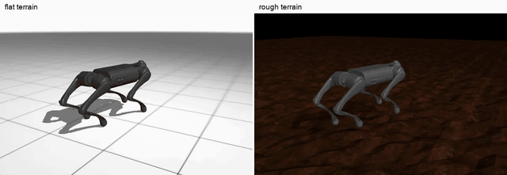
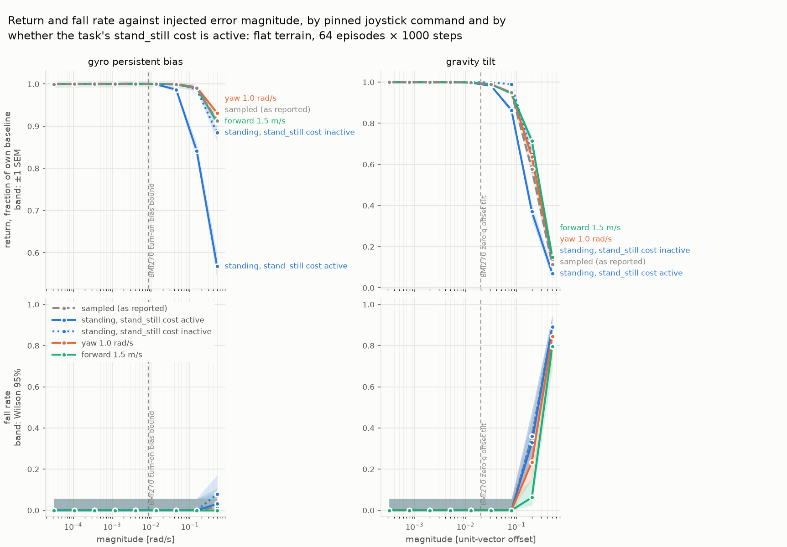
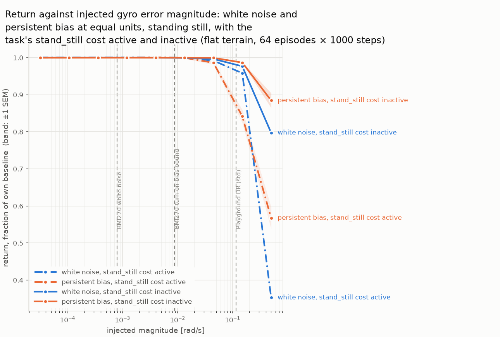

# And Your IMU Can Sing: a differentiable sensor model that broke nothing

I built a physics-parameterized IMU model to find failure modes in a quadruped locomotion policy. Turned out that nothing in the component parameter space was able to break it and the errors that actually mattered were at the system-level: mounting misalignment and latency.

Repository is here: https://github.com/stosifian/imu-diff-sim/tree/main

## 1. The question and the short answer

I've been seeing a lot of dialogue about Sim2Real in the (mostly online) robot circles I've found myself in and given my background as a sensing system engineer (mainly magnetic position sensors for camera actuators), I wanted to explore a sensing-first approach to robot simulation. The problem I posed is as follows: if you could create a differentiable, physics-based model of a sensor (in this case, an IMU), what insight could you gain into a robot policy's sensitivity to physically derived attributes of the IMU, and hence search out failure modes in simulation that would correspond to different attributes on a datasheet? Maybe a bit ambitious for a first robot simulation project, but something I felt with coding agents I could get some nice insight in to help guide my understanding :)  

TLDR: what I found is that (at least for the walking quadruped problem) there aren't policy failures in the physics-parametrized space of the IMU (Allan-variance terms: noise density, bias instability, random walk) but rather from sources that wouldn't be captured at the component level - misalignment and latency.

| Premise | Verdict |
|---|---|
| failures exist in the physics-parameterized noise space | **no** — white noise clear by 348×, bias and scale never knee in range |
| …but they exist in attitude error | **yes** — onset 4.1–5.1° across every command regime, and the in-field stack-up is the same size at 4.4° |
| gradients flow through the simulator | **no** — no horizon clears both thresholds fixed before the run |
| randomized smoothing rescues them | **no** — no axis clears the threshold fixed before the run |
| adaptive search beats uniform sampling | **on hit rate only** — 13× more failures found |
| …and finds *worse* failures | **no** — worst case 17 % against 16 % |
| …and finds *diverse* failures | **no** — collapsed to one mode |

## 2. Why this looked like a good bet

What typically occurs within robot simulation is this notion of domain randomization. For more kinematic and rigid-body problems, having parameters like mass, friction, and rigidity be randomized over a window of values can give you some valuable insights into the sensitivity of your policy to variations in the physical environment and ideally give you some data on how to best generalize it. I was curious taking this approach but more on the perception/sensing side. Domain randomization here is not a physics-informed model, at least from the available datasets I was seeing for IMU-locomotive tasks. It seems that a rather over-conservative approach is taken, with a common bounding value of +/- .2 rad/s (STD = 0.12 rad/s), which is a ways away from what's quoted in IMU spec sheets (for example, BMI270 quotes gyro white noise @ 50 Hz a STD = 7.9e-4 rad/s). This was seen across 7 different publicly available models that I came across: Go1 joystick, Go1 handstand, Go1 getup, G1, Berkeley Humanoid, Apollo, T1 - quadrupeds and bipeds alike. It seems to be more of a default than an actual physically grounded value. So from that, I felt initially a bit optimistic about my hypothesis: if domain randomization is not physics-informed, a physics-parametrized search should find failures that it misses. 

So the plan was: 
1) Build a differentiable, parametrized IMU model
2) Wire it into a locomotion policy
3) Compare gradient-informed adversarial search against uniform domain randomization, and a gradient-free adaptive baseline

As you'll see, Steps 1 and 2 got built but Step 3 was built without its central premise: gradients
through this simulator turned out to be unusable at any horizon where a failure could develop.

## 3. The IMU Model

First, the physics-based IMU model. It follows the Kalibr convention which is common in the robotics community to describe IMU error as the following: a white noise term, a bias that evolves as a random walk, a turn-on bias fixed for the episode, and a per-episode scale factor. I used the Bosch BMI270 (a common MEMs part found in wearables and hobby robotics) as the reference, parametrizing the model as such. Bosch specifies noise density but no random walk, so the noise nominals come from one community characterization of a BMI270 inside an OAK camera (https://github.com/luxonis/depthai-core/issues/886), with the datasheet as a cross-check rather than source; only the scale factor bound is datasheet-derived.

One key implementation detail to maintain the differentiable construction: the noise is generated outside the model by drawing unit-variance random numbers once, and the parameters simply scale them as ordinary multiplication so the gradients can reach them. Since the random draw is fixed, two different parameter settings can be evaluated against identical noise, so any difference is attributable to the parameter rather than sampling luck. Same reason as why you'd test two different controllers or sensor designs against the same recorded vibration profile or walking trace.

  
     
  <em>Allan deviation of a simulated trace against the analytic model</em>

With the model developed, I of course wanted to validate that the error terms actually match expectation. I wanted to make sure that each error term was properly accounted for and the best tool to do this is the Allan deviation. You can accomplish this by taking a long recording from a motionless sensor, average it over windows of length τ and see how much consecutive window averages differ from one another. Then repeat for many τ and plot the result.

For the model cross-check, I spun up a separate Claude Code session to generate an independent validation package. Both the internal and external cross checks passed (some spurious artifacts were also introduced to ensure the checks would also catch failures and not blindly pass everything).

A note: the model is written in JAX so it can be traced inside the compiled MJX rollout rather than added after the fact. Using a NumPy model would require a host callback every step.

Before ordering hardware, I tried grounding the model against a public dataset - EuRoC, a drone-flight set whose IMU is well characterized and widely used for VIO benchmarking (and one I worked with previously when getting my feet wet with calibration). The issue is that Allan deviation needs a stationary recording, and EuRoC has no static segment anywhere. Running the estimator on it and it hands back a gyro noise density of 0.025 rad/s/√Hz against a published 1.70e-4  (150× high) with no error and no warning. You can see the problem in the curves below: a stationary record falls as τ^(-1/2), and these rise. 

  
     
  <em>Allan deviation of EuRoC gyro data, which has no static segment — forced through, the estimator returns 150× the published noise density</em>

Now being from a hardware background, the ultimate check for your simulation passing the sniff test is actually grounding it to real world data! If you can't ground your sim, then your playing with imaginary data. My plan was to order a few units of the Arduino Nano 33 BLE (which has an integrated BM270) and do some bench measurements and compare those to the model. However given the week-long lead time and results from the later steps, I ultimately opted out of doing so given that the veracity of the model was not the ultimate issue with the approach. I do hope to do some more HW measurements soon for future projects!

## 4. What I measured

  
     
  <em>The policy under test: Go1 joystick task, command pinned at 1.0 m/s forward (just for this example), 10 s at 50 Hz. Left, flat terrain; right, rough.</em>

Before jumping into the results, I wanted to first cover in some more detail what the policy and scanerio is here, since everything below is a measurement on it. The testbed is MuJoCo Playground's Go1 joystick task: a Unitree Go1 quadruped tracking a commanded forward, lateral and yaw velocity, on flat ground and on rough terrain. The policy is a feedforward MLP (512/256/128) trained with PPO, running at 50 Hz over 20-second episodes. It is frozen so nothing below retrains it. It reads a 48-dimensional observation of which the IMU is six numbers: three gyro rates and the three components of gravity projected into the body frame. So "injecting IMU error" throughout this write-up means corrupting six of forty-eight inputs.

Now I had an IMU model in place and started wiring it into the policy and finding that initially nothing in the policy was breaking from extreme IMU parameters (will get to this in a minute). After some snooping around to see if there were any bad assumptions with the model or data plumbing issue, I realized I could look at the policy and directly measure its sensitivity to any of the IMU parameters, using an OFAT approach (one-factor-at-a-time). This was a methodology I had learned while at Apple, emerging from looking at hardware problems with a 'guaranteed-by-design' approach. One way of doing this if you have a physical model, is to sweep through each parameter input to your model and gauge the response to see how truly sensitive it is. I figured why not do the same with the policy - it is a model after all! With that, I architected a direct sensitivity sweep of each of the IMU inputs to the policy and looked at the fail rate as a response. Doing so was probably the most insightful step in the project. Let's take a deeper look.

### 4.1 Nothing in the noise space breaks it

First, looking at noise. As you can see from the plot, the key takeaway was that the policy was quite insensitive to noise, requiring 348x the BMI270 spec to reach the knee point in the return-vs-magnitude curve. Not a total surprise based on my intuition. What was surprising was the insensitivity to bias - essentially no knee in the swept range. Scale error a similar story. What proved to be the main killers were gravity tilt (which I would describe as non-uniform error across X, Y, and Z) and IMU latency (which can arise from any filter delays or FIFO reading) - both non-component related sources of error (both 4x margins).

  
       
  <em>All 5 error channels, return and fall rate</em>

  
       
  <em>White noise against a persistent bias at equal magnitude</em>

### 4.2 What the metric was actually measuring

Now, you might be wondering if there are certain motion profiles that would be more sensitive to IMU parameter extremes. What I found initially was that the standing-still profile seemed to be the most sensitive to IMU errors, however that actually turned out to be an artifact of the reward. Looking into the Go1 task, there is a 'stand_still' cost that penalizes any joint deviation from the default pose, *but* only when ||command|| < 0.01, which is true for the whole pinned (0,0,0) profile and 1.5 % of the sampled profile (and 0% of the yaw and forward ones), so the pinned profile was penalized for something the non-stationary motion profiles were not. This was proven by pinning the sweep at (0.02, 0, 0) - a hundredth of a m/s above the gate, essentially the same physical scenario - and seeing the sensitivity disappear. The conclusion is that the score is a weighted sum of several terms, so a drop in it doesn’t tell you the robot walked worse — only that something in the sum changed. Everything that actually describes the walking (speed-tracking error, fall rate, survival time) stayed put. 

| Factor | sampled | standing, gated (0,0,0) | standing, ungated (0.02,0,0) | yaw 1.0 rad/s | forward 1.5 m/s |
|---|---|---|---|---|---|
| gyro bias, 10 % knee | none in range | **0.092 rad/s** | none in range | none in range | none in range |
| gyro bias, margin over turn-on bias bound | >57x | **10.5x** | >57x | >57x | >57x |
| gravity tilt, 5 % onset | 4.41° | **2.33°** | 5.07° | 4.41° | 4.10° |
| gravity tilt, 10 % knee | 5.14° | **3.44°** | 5.81° | 5.25° | 5.45° |
| gyro white noise, 10 % knee | 0.274 rad/s | 0.168 rad/s | 0.251 rad/s | not swept | not swept |
| gyro white noise, margin over BMI270 white | 348x | 213x | 318x | not swept | not swept |

  
         
  <em>Gyro bias and gravity tilt under four joystick command regimes</em>

  
         
  <em>White noise against persistent bias, standing still, with the stand_still cost inside and outside its gates</em>

### 4.3 It generalizes to rough terrain

One other check I had wanted was to see if the IMU insensitivity was specific to walking on flat terrain, where joint-encoder redundancy would depend on predictable terrain.  With rough terrain, I had expected the margins the redudancy to degrade and hence the IMU margins to shrink - they did not. Everything besides the terrain was the same: class, observations, domain randomization, budget, and episode length.

  
   
  <em>The same five channels on rough terrain</em>

### 4.4 Corruption-insensitive is not unused

Given these results, I started to wonder if the IMU itself is at all even needed? With the previous runs, the IMU was "corrupted" (error injection) and the policy performed robustly still. So naturally, removing the IMU came to mind - first as a sanity check, and second as a sort of 'ultimate' sensitivity check.

To clarify, by 'remove' here I mean holding the channels at a constant value. The gyro slots are zero and the gravity slots to nominal upright (z = -1). As a result, the policy is still reading a legit value, just one that's not informative. Held at zero, the gyro costs ~70% of return for both terrains and puts the robot on the ground roughly half of all episodes. Gravity is interesting - held upright it costs 6% of return and 3% of episodes on flat ground, and 66% of return with 92% falls on rough.

For the rest of the write up, one important note: while holding gravity at a constant costs 6% on flat ground, tilting it by 11˚ costs 42%(!), which is an offset of 0.19 in the unit-vector units in the figure plots. So a wrong attitude estimate is much more punishing than a 'missing' one, and everything that goes wrong in the field produces wrong values, not missing ones (unless you have strange assert statement hiding in your code). Section 6 goes into detail for this.

  

### 4.5 The gradients don't work

Returning to the original premise, besides the fact that the OFAT approach showed I couldn't get a direct sensitivity to the IMU parameters, the gradients didn't pan out either. The whole point of a differentiable simulator was that I wouldn't have to sample different IMU values hoping to break the policy, but rather calculate how the performance changed w.r.t to the parameters (i.e. the gradient) and walk uphill, essentially closing the loop to finding the failure mode.

Before running the sweep, I wrote down what could count as a usable gradient: under 20% disagreement with the finite-difference estimate and sign agreement > 0.8. Both are recorded in the docstring of scripts/spike_gradients.py. 

| rollout horizon | simulated time | AD vs finite difference | sign agreement across draws |
|---|---|---|---|
| H = 10 | 0.2 s | **1.7 %** | 0.78 |
| H = 25 | 0.5 s | 78 % | 0.78 |
| H = 50 | 1.0 s | 98 % | 0.67 |
| H = 100 | 2.0 s | 104 % | 0.61 |

Peeking at the table, you can start to see the issue. At H=50 (only a second into the simulation) the autodiff gradient disagrees with a finite difference of the same function by 98%. At H = 100, the sign agrees only 61% of the time - a measurement with no systematic component. No horizon cleared both of my earlier stated conditions. Randomized smoothing didn't recover anything either.  

### 4.6 The search that remained

Given the issue with the gradients in this problem, can adaptive gradient-free search find failures more efficiently than uniform sampling? 

For the approach, two methods (both get 240 tries):

Method A - uniform, draw misalignment vectors uniformly at random from the ±5°/axis box and evaluate each. No adaptation; it never uses what it learned from earlier samples.

Method B - cross entropy method (CEM), sample a population from a Gaussian, keep the worst-performing elites (worst = lowest return, since you’re hunting failures), refit the Gaussian to those elites, repeat. Adaptive, but gradient-free.

Both methods were scored on the same 16 simulated runs so neither could get lucky from a few easy runs. Failure was defined as the robot losing more than 10% of its usual score (same 10% used everywhere else in the write-up). The built-in simulator's sensor noise was turned off as it would've snuffed out any couple degrees of mounting error.

Method B's CEM found 182 failures compared to Method A's 14. The thing is that the hit rate doesn't tell you much on its own. It only tells you how many of the tries landed in the fail region, and staying in it pushes the number to 100% automatically (visible in the right panel in the plot below - CEM curve goes straight after about 75 tries and doesn't bend again).

Even on how bad the worst failure was, there is little difference between the two methods. Method B's worst cost 17% of the robot's score; Method A's cost 16%. CEM also never pushed as far into the box as uniform did (7.66° against 7.98°) since it got locked in the first bad region it found and used the rest of its tries confirming it. Also note that the x-axis collapses a three-component rotation into one number, so every point at 7° is a different mounting error pointed a different way, costing anywhere from 10.8 down to 10.2, so magnitude alone doesn’t tell you whether the policy fails. Neither method reached the corner at 8.66°, where interpolating the OFAT curve gives around 31% degradation against the 17% the search actually found.

  

## 5. Why it failed: Allan variance characterizes integration

So, it seems like the original hypothesis I had seemingly 'failed' - but why is that? A couple ideas.

With IMUs, you traditionally pay the penalty via integration. The averaging time τ is the independent variable of the Allan curve and the policy itself has no accumulator as it's feedforward multi-layer perceptron with no recurrent state. Hence, the errors from the IMU model never get a chance to actually acummulate, they're at best treated as an overall noise on the measurement. So, this wasn't the best problem to model IMU physics for given the lack of integration/accumulation in the policy. Also worth stating that the policy itself was trained with +/- 0.2 rad/s of per-step random noise and was never exposed to a bias. If the exposure (or lack there of) was truly an issue, then we'd see the policy struggle with bias, but that turned out not to be the case, with white noise breaking it first. 

The other idea is simpler and doesn’t involve integration at all. A constant offset is one wrong number, and everything else the policy reads (joint angles, the gravity vector, the velocity estimate) stays consistent around it, so there’s plenty left to lean on. White noise hands it a different wrong number every step, and there’s nothing to lean on. That gets you white-before-bias too, with no accumulation anywhere in the argument. A caveat is that the velocity estimate is ground truth in the simulation, but on real hardware that would come from a state estimator that integrates the IMU, so by nothing integrating here, I mean from the policy.

The measurement that would separate them is a bias that ramps rather than one that sits still (like a temperature drift). Sweep the ramp rate and find where the policy starts to care. If accumulation is what matters, a ramp should hurt where a constant does not, and the rate at which it bites should scale with the episode. If redundancy is what matters, the ramp rate should barely register. I haven’t run it — which makes this the explanation I believe, not the one I’ve tested.

Also worth briefly stating that there is no sensor fusion going on here, so that wouldn't explain the insensitivity. There's no filter, no history, and gravity is ground truth in the sim.

## 6. The error budget that actually binds

With all this exploration, it'd be at least worth laying out an error budget (every sensing engineer's occasional best friend). First note is that gravity tilt here is a direction error, not a magnitude one. The accelerometer vector gets normalized before reaching the policy so any uniform scale error applied to all three axes will result in zero tilt. What escapes the normalization is any error term that makes the axes disagree with each other. Given the presence of gravity, that means any additive term on all three axes (let's call it δ ) would result in a tilt after normalization. This can be from a variety of reasons: temperature (.25 mg/K offset drift), cross-axis sensitivty (1%), accelerometer zero-g offset, and other sources not quoted in the datasheet: package and board stress, mechanical shock, aging/lifetime drift. 

The chart below is a stack up, left-to-right the four datasheet contributors (all under 1.2˚). Since they're independent, they combine in the RSS to 1.41˚. Then I assumed a 3˚ mechanical mounting tolerance (not measured but assumed based on literature/references I've seen), adding directly gives 4.41˚ since mounting is systematic. With misalignment mounting considered, that does put the budget in the negative for the walking forward case, getting us past first detectable degradation in the fastest case - no physics-modeling needed, just some system level considerations. 

So the budget that binds is mechanical. Worse, every dominant contributor here is persistent, per-axis, and slowly varying — precisely the structure that per-step uniform randomisation does not have.

  

## 7. What I'd do next

Given all the negative discoveries here, there's a *lot* I could do for follow ups. I think the biggest to state would be to test this on a system that actually integrates the IMU readings - so anything reliant on inertial odometry or VIO/LIO (drones, AR headsets, phone tracking). 

Another would be explicitly including misalignment as a sim-to-real study, though grounding the data in actual mounting-error distributions from hardware (not something I have access to currently).

Additionally, given that integration of the IMU outputs is what's been hypothesized as a miss for this approach, one other method to try is using a policy with a memory-mechanism (like recurrence)

## 8. Limitations

Worth outlining some of the key limitations with this experiment:

- Severity definition: worst-case value found by the search in the box cost 17% of the return, so more a degradation vs a collapse
- Sampled command space: four pinned regimes (forward, sampled, yaw, standing) - no crouching, backing up, or transients
- Return is a composite: worth stating again that the sweep out measures policy x reward function
- There is more to model than just a policy and the components that feed into it
- Simulation only: no hardware validation of policy nor modeled sensor (besides the community char)
- Differentiability not usable: the main motivation for the project turned out to not be usual

## 9. What I learned (as a newcomer)

- Think about the problem you're trying to solve (from a policy/robot perspective) before proposing a differentiable sensor - for next time :)
- Fold in related-system errors into the sensor model (this was something I dealt with a lot for magnetic sensing: many of the error sources are not component related but arise from the entire magnet-sensor system, things like air-gap variation, magnet permeability variation, etc.)
- The reward function is a key part of the instrument 

## Appendix: prediction record

I kept a prediction log in the lab notebook: the first five recorded as a block before the opening sweep, the rest written down as each experiment was set up. 4 out of 11 of the calls were right. What’s interesting isn’t the score, it’s which ones missed: every time I tried to guess an actual magnitude from sensor physics I got it wrong (bias would knee before white noise, 50% scale error would cost something, tilt wouldn’t matter, the standing effect would hold up under the control). The two calls that did survive weren’t really predictions so much as mechanisms I’d already read off a measurement in hand. 

So I’d say that’s the real argument for doing it in this order. I started out wanting to build a gradient search and ended up doing a sensitivity sweep first, and that sweep is the easy part: no differentiable simulator, no search machinery, no GPU, just a trained policy and asking whether the thing you’re about to search is something the system even responds to.

| | Prediction | Outcome |
|---|---|---|
| A | Gyro white noise: no failure at datasheet-realistic magnitudes | **Right** — the knee sits at 348× the BMI270 spec |
| B | Latency: the most sensitive channel | **Right** — but gravity tilt ties it at 4× |
| C | Gyro bias: marginal, and it decides the result | Wrong — no knee at all |
| D | Gyro scale error: failure possible | Wrong — 50 % costs 3 % of return |
| E | Gravity tilt: no failure | Wrong — one of only two channels that fail |
| F | Rough terrain shrinks the gyro margins | Wrong — they did not move |
| G | Gravity ablation hurts more on rough terrain | **Right** |
| H | No knee moves more than one grid point across command regimes, except gravity when standing | Wrong — bias moved ~1.4 |
| I | Standing still separates white from bias, bias worse — averaging over an episode washes out white noise as 1/√N but leaves a constant offset untouched, and that should bite hardest where the true rate is zero | Wrong — and scored right until the control run; the separation was the `stand_still` reward term |
| J | Most of the standing effect survives the control: bias knee 0.09–0.20 rad/s, gravity onset below 4.41° | Wrong — 0.418 rad/s and 5.07° |
| K | White's ungated knee lands near the sampled value and the separation collapses | **Right** — 0.251 vs 0.274 rad/s |

## References

**Sensor and noise modelling**

- Bosch Sensortec. *BMI270 — Smart IMU with advanced features.* Datasheet BST-BMI270-DS000, Rev 1.5, March 2023. <https://www.bosch-sensortec.com/products/motion-sensors/imus/bmi270/> — source for the gyro noise density and the scale-factor bound.
- Luxonis. *BMI270 Allan variance characterisation inside an OAK device.* depthai-core issue #886. <https://github.com/luxonis/depthai-core/issues/886> — the single community measurement the random-walk nominals rest on.
- P. Furgale, J. Rehder, R. Siegwart. *Unified temporal and spatial calibration for multi-sensor systems.* IROS, 2013. Conventions and parameter names follow the Kalibr IMU noise model: <https://github.com/ethz-asl/kalibr/wiki>
- N. El-Sheimy, H. Hou, X. Niu. *Analysis and modeling of inertial sensors using Allan variance.* IEEE Transactions on Instrumentation and Measurement, 57(1), 2008 — the white-noise and random-walk slope identification used throughout section 3.
- Analog Devices. *ADIS16448 — compact, precision ten degrees of freedom inertial sensor.* Datasheet — the reference part whose EuRoC tuning values appear in the self-consistency figure.

**Data**

- M. Burri et al. *The EuRoC micro aerial vehicle datasets.* International Journal of Robotics Research, 35(10), 2016. DOI 10.1177/0278364915620033. <https://projects.asl.ethz.ch/datasets/euroc-mav/> — proposed as a grounding dataset and rejected for Allan fitting; the `sensor.yaml` Kalibr values are estimator tuning, not a characterisation.

**Simulation and policy**

- K. Zakka et al. *MuJoCo Playground.* arXiv:2502.08844, 2025. <https://arxiv.org/abs/2502.08844> — the Go1 joystick task, its reward terms including `stand_still`, and the ±0.2 rad/s gyro domain randomisation default.
- E. Todorov, T. Erez, Y. Tassa. *MuJoCo: a physics engine for model-based control.* IROS, 2012 — and MJX, its JAX implementation, which the IMU model is traced inside.
- C. D. Freeman et al. *Brax — a differentiable physics engine for large scale rigid body simulation.* 2021 — the PPO implementation and network sizes used to train the frozen policies.
- J. Schulman et al. *Proximal policy optimization algorithms.* arXiv:1707.06347, 2017.
- Unitree Robotics. *Go1 quadruped.* The platform the task models.

**Methods and prior work**

- H. J. T. Suh, M. Simchowitz, K. Zhang, R. Tedrake. *Do differentiable simulators give better policy gradients?* ICML, 2022 — the prior result that motivated checking gradient quality through contact before trusting it, and the reason criteria C1–C4 were set in advance.
- P.-T. de Boer, D. P. Kroese, S. Mannor, R. Y. Rubinstein. *A tutorial on the cross-entropy method.* Annals of Operations Research, 134(1), 2005 — the CEM arm in section 4.6.
- J. Tan et al. *Sim-to-real: learning agile locomotion for quadruped robots.* Robotics: Science and Systems, 2018 — per-episode IMU bias randomisation does appear in the wider literature, so the "domain randomisation omits structured errors" claim in section 2 is true of this simulator's defaults, not of the field.
